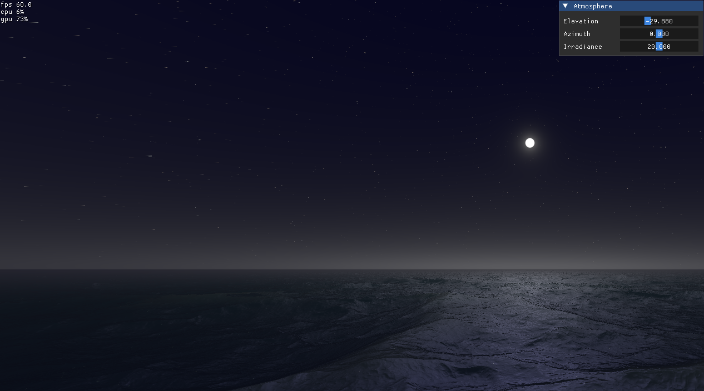

# Nishita 式单次散射 + 高度场海水模拟

## 散射

白天走 Nishita 式单次散射：沿视线只积分一次散射，不再散射第二次，也不查预计算 LUT。散射系数按 Bruneton 2008 写成 1/m，标高和半径用 m。地心在 `(0, -6361 km, 0)`，大气外半径 6369 km。样本高度是到地心的距离减去行星半径。Rayleigh、Mie 密度分别按 8000 m、1200 m 指数下降。

视线先与大气球求交（`escape`），再等分 64 步。μ 是视线和太阳方向的点积。Rayleigh 相位是 `3/(16π) (1+μ²)`。Mie 相位是 `miePhase`，g = 0.76：

`3/(8π) · (1-g²) · (1+μ²) / ((2+g²) · (1+g²-2gμ)^1.5)`

每一步再向太阳走 4 步，累积阳光的光学厚度。该步贡献是

`exp(-(τR+τM)) · (βR ρR pR + βM ρM (pM + 10 pSharp)) · exp(-τSun) · dt`

视线消光里的 Mie 用 `kMieExtinction`（散射系数除以 0.9），散射项里的 Mie 用 `kMieScattering`。`pSharp` 是 g = 0.999 的同一相位，但 μ 来自屏幕平面距离，日盘在屏幕上是圆。积分结果乘 Irradiance，再做 `1/2.2` 的 gamma。

太阳仰角小于 0 时 `status.w = 1`，月亮方向是把仰角取反。这条路径不乘 Irradiance。视线仍累积 Rayleigh 和夜间 Mie 消光；另外向略高于地平线的方向、以及月亮方向各走 4 步透射。夜天光用 g = 0.1 的 Mie 相位，月光用 `miePhaseSoft`（g = 0.999，分母里用 `1+g-2gμ`）。月盘是屏幕平面上半径 0.05、羽化 0.01 的圆。星光按屏幕方向采样后叠加上去。

## 海水

海面是高度场，结构来自 `assets/shader.txt` 里的 Seascape。水平坐标上叠多层波：每层是时间上反向传播的两列，波形把 `1-|sin|` 和 `|cos|` 混在一起，再做 choppy 次幂。求交用 3 层，法线用 5 层。层间频率乘 1.9，振幅乘 0.22，平面旋转 `mat2(1.6, 1.2, -1.2, 1.6)`。

求交解的是 `p.y - h(p.xz) = 0`。射线在 `[0, 50000]` 上做 7 次假位法：`t = mix(tmin, tmax, hmin/(hmin-hmax))`。法线用更高层数高度场的差分，差分步长是距离平方乘 `0.1/宽度`。

颜色在水体和反射天空之间按 Fresnel 混合。Fresnel 是 `(1 - n·(-视线))` 的三次方再乘 0.5。混合结果再乘一次天空色。水体本身带一个很陡的 `n·l` 项。波面高于 `SEA_HEIGHT` 时按超出量和距离衰减加一点水色。高光是反射方向和光方向的点积，指数 40；夜间再叠加指数 10、方向为月亮的高光。夜间喂给海面的主光不是月亮本身，而是同一方位、竖直分量 0.08 的方向。

视线朝下时，先求与 `y = 0` 的交点，把方向的 y 分量取反，再用同一套大气作为反射天空。夜间这条反射把夜天光和星光乘 0.6，月盘乘 0.2。最后按视线俯角在反射天空和海面颜色之间混合。
